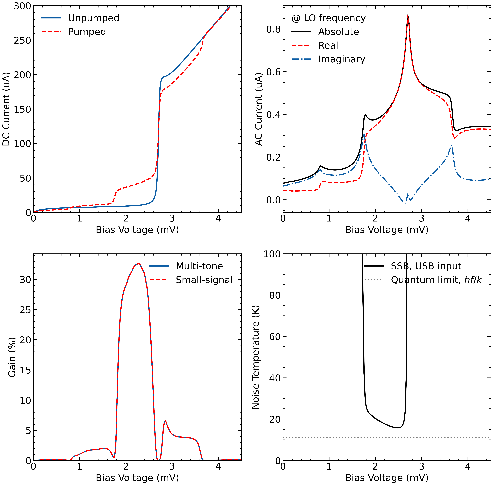

QMix
====

**Quantum Mixing software**

[](https://badge.fury.io/py/qmix)
[](https://github.com/garrettj403/QMix/actions/workflows/ci.yml)
[](https://github.com/garrettj403/QMix/actions/workflows/linter.yml)
[](https://github.com/garrettj403/QMix/blob/master/LICENSE)

QMix is used to simulate the quasiparticle tunneling currents in Superconductor/Insulator/Superconductor (SIS) junctions. In radio astronomy, these junctions are used for heterodyne mixing at millimeter and submillimeter wavelengths. QMix can be used to simulate the behavior of SIS mixers, optimize their performance and analyze experimental data.

In order to calculate the quasiparticle tunneling currents, QMix uses *multi-tone spectral domain analysis* (see [references](https://garrettj403.github.io/QMix/references.html#references-related-to-multi-tone-spectral-domain-analysis)). Among other applications, this makes QMix ideal for simulating power saturation, higher-order harmonics, sub-harmonic pumping, harmonic mixing and frequency multiplication.

**Website:** https://garrettj403.github.io/QMix/

Capabilities
------------

**Tunneling currents and harmonic balance**
- Quasiparticle tunneling currents for any number of tones and harmonics (multi-tone spectral domain analysis), with a Fourier-shift method that keeps simulations with many tones practical.
- Harmonic balance with an analytic Jacobian and a line search, to find the junction voltages for a given embedding circuit.
- Response functions from ideal or model I-V curves, or from measured DC I-V data (Kramers-Kronig transform included).

**Mixer analysis**
- Small-signal (Tucker) analysis: conversion gain, shot noise (including its thermal and quantum limits) and noise temperature, at any IF frequency, including an IF of zero.
- Thermal noise of the embedding circuit (Callen-Welton), and of lossy embedding networks.

**Several junctions**
- Twin-junction circuits and series arrays, coupled through a multi-port embedding network.
- Junctions with different areas, gap voltages, normal-state resistances and I-V curves.
- DC bias networks for series arrays (e.g., with a bias resistor).

**Embedding circuits**
- S-parameter networks: read Touchstone files (e.g., from HFSS), connect and terminate networks, and get Thevenin equivalent circuits from them.
- Circuit elements: transmission lines, microstrip, coplanar waveguide, rectangular waveguide, radial stubs, lumped elements, and ideal components (transformers, hybrids, circulators, attenuators, antennas, de-embedding).
- Superconducting films: Mattis-Bardeen conductivity and surface impedance, including the kinetic inductance and loss of superconducting microstrip.

**Experimental data**
- Analysis of measured DC and pumped I-V curves and IF spectra: recover the embedding impedance and voltage, and the gain and noise temperature (Y-factor, shot-noise calibration).

Many of these results are checked against [SuperMix](http://www.submm.caltech.edu/supermix/), an independent C++ library for SIS mixers.

Limitations
-----------

**Physics**
- Only the quasiparticle tunneling current is simulated: there is no Josephson (pair) current, so no Shapiro steps, Josephson noise or magnetic field.
- The response function comes from one DC I-V curve, so heating and changes of the gap with LO power or temperature are not included.
- Noise is only calculated by the small-signal analysis, which assumes a single LO (with harmonics) and weak signals. Multi-tone simulations give currents and gain, but not noise (e.g., under saturation or with a strong second tone).
- Harmonic balance finds one solution per bias point, so hysteresis in series arrays (e.g., up/down bias sweeps) cannot be followed.

**Embedding circuits**
- The thermal noise of a lossy network is calculated at one temperature; elements don't have their own temperatures.
- There are no active devices (e.g., IF amplifiers): the IF chain is described by its noise temperature only.
- The coplanar waveguide model is lossless (no conductor loss or kinetic inductance), and there is no stripline model.

**Numerics**
- The cost of the tunneling current grows quickly with the number of tones and with strong pumping of low-frequency tones (many Bessel terms). The Fourier-shift method helps, but it is less accurate (~1e-7 to 1e-9).
- Frequencies are matched after rounding, so tones closer than ~1e-4 of the gap frequency are treated as the same frequency.
- Harmonic balance can converge slowly for very strong pumping, sharp gap knees and series arrays.

Getting Started
---------------

The easiest way to install QMix is using ``pip``:

```bash
# for latest release (from PyPI)
python -m pip install QMix

# for latest commit (from GitHub)
python -m pip install git+https://github.com/garrettj403/QMix.git
```

Take a look at the [QMix website](https://garrettj403.github.io/QMix/) for more information on how to use the QMix package and examples showing how to simulate SIS junctions. If you run into any problems, please create a new issue through the [issue tracker](https://github.com/garrettj403/QMix/issues) with the ``help wanted`` or ``question`` tag. In your message, make sure to include your operating system, Python version, and package versions for QMix, Numpy, SciPy and Matplotlib.

Contributing to QMix
--------------------

[](https://github.com/garrettj403/QMix/issues)
[](https://github.com/garrettj403/QMix/commits/master)

If you would like to contribute to the QMix project, please take a look at the [contribution instructions](https://github.com/garrettj403/QMix/blob/master/CONTRIBUTING.md). This document includes information on reporting bugs, requesting new features, creating pull requests and contributing new code.

To get a local copy of QMix running:

```bash
# Download QMix
git clone https://github.com/garrettj403/QMix.git QMix
cd QMix/

# Create a virtual environment using Anaconda
conda env create -f environment.yml
conda activate qmix

# Install QMix
python -m pip install -e .

# Test installation
pytest --verbose --color=yes tests/
```

Examples
--------

QMix can be used to simulate a wide variety of SIS junction behavior. A simple example is shown below for simulating an SIS mixer at 230 GHz. You can find more examples in the ``QMix/notebooks/`` directory or on the [QMix website](https://garrettj403.github.io/QMix/single-tone-simulation.html). 



Citing QMix
-----------

If you use QMix, please cite the following papers:

[](https://doi.org/10.21105/joss.01231)

    @article{Qmix1,
      author       = {J. D. Garrett and G. Yassin},
      title        = {{QMix: A Python package for simulating the quasiparticle tunneling currents in SIS junctions}},
      publisher    = {Journal of Open Source Software},
      month        = mar,
      year         = 2019,
      volume       = 4,
      number       = 35,
      pages        = 1231,
      doi          = {10.21105/joss.01231},
      url          = {https://doi.org/10.21105/joss.01231},
    }

[](https://doi.org/10.1109/TTHZ.2019.2938993)

    @article{Qmix2,
      author       = {J. D. Garrett and B.-K. Tan and F. Boussaha and C. Chaumont and G. Yassin},
      title        = {{Simulating the Behavior of a 230-GHz SIS Mixer Using Multitone Spectral Domain Analysis}},
      publisher    = {IEEE Transactions on Terahertz Science and Technology},
      month        = nov,
      year         = 2019,
      volume       = 9,
      number       = 6,
      pages        = {540--548},
      doi          = {10.1109/TTHZ.2019.2938993},
      url          = {https://ieeexplore.ieee.org/document/8822760/},
    }

You can also cite a specific version of QMix by citing the appropriate Zenodo archive:

[](https://doi.org/10.5281/zenodo.2538162)

    @article{Qmix3,
      author       = {J. D. Garrett},
      title        = {{QMix}},
      month        = jul,
      year         = 2020,
      publisher    = {Zenodo},
      doi          = {10.5281/zenodo.2538162},
      url          = {http://doi.org/10.5281/zenodo.2538162}
    }

License
-------

QMix is released under a [GNU General Public License, Version 3](https://github.com/garrettj403/QMix/blob/master/LICENSE).
